# lazada-scout

[](https://github.com/bayanovea/lazada-scout/actions/workflows/ci.yml)

A shopping scout for Lazada Thailand, operated by Claude Code. I give it a household list in
Russian, often without knowing the Thai or even the right English name for the thing ("the mop
with the spinning bucket"). The tool fetches the listings, ranks them, and Claude Code splits
every item into the two or three subtypes that are a real choice, picks a few candidates each and
says in one line why. I read a short annotated list with links and decide in a minute instead of
browsing for half an hour. I never search Lazada myself; the only hand work is pasting one script
into the browser console.

## How it works

```mermaid
flowchart LR
    L["shopping list<br/>in Russian"] --> Q["queries.py<br/>item → subtype → Thai/English query"]
    Q --> C["console_fetch.js<br/>pasted into DevTools on lazada.co.th"]
    C --> R[("data/raw/&lt;md5(query)&gt;_p1.json<br/>raw listings")]
    R --> A["analyze.py<br/>local sellers · Bayesian rating · log-sold bonus"]
    A -->|ranked table| K["Claude Code<br/>reads, chooses subtypes and candidates"]
    K -->|writes| P["picks.py<br/>item → subtype → (id, comment)"]
    P --> M["render.py<br/>looks every number up in data/raw"]
    R --> M
    M --> S["shortlist.md<br/>links · price from · rating · reviews · sold"]
```



The split is strict. Code does the deterministic part: fetching, filtering out cross-border
sellers, ranking, lookup, rendering. Claude Code does the judgement: which subtypes matter for
this item, which three listings deserve a place, what to say about each. Its output is not prose
but a Python data structure in `picks.py`, so a shopping round is a diff I can read and correct.
`render.py` then fills in every price, rating, review and sold count from the raw data, so the AI
never types a number.

## Try it in two minutes

You need Python 3.11 or newer. The repository ships with a sample: two items (a mop and a table
scale), two subtypes each, three real candidates per subtype, with the raw listings trimmed to the
fields the scripts read.

```sh
git clone https://github.com/bayanovea/lazada-scout && cd lazada-scout
pip install -r requirements.txt
python -m pytest -q
python analyze.py          # the ranked table Claude Code reads
python render.py           # regenerates shortlist.md; prints "missing ids: []"
```

`analyze.py` prints, per subtype, the local candidates with at least five reviews, best first:

```
== с ведром-центрифугой [ไม้ถูพื้น ถังปั่น] — 3 local w/ >=5 reviews
  ฿   168 | 4.93★  9428 rev |   26900 sold | Bangkok    | 5307905593 | Floor Mop Standard Size Mop Spinning Bucket
  ฿  1165 | 4.96★  1711 rev |    4700 sold | Bangkok    | 11668472 | Poly-Brite โพลี-ไบรท์ ชุดถังปั่น รุ่นเฮอร์ริเคน
```

and `shortlist.md` is what I read:

```
## Швабра
**С ведром-центрифугой** — _ведро в комплекте_
- [базовый набор, +5 насадок](https://www.lazada.co.th/products/pdp-i5307905593.html) — от ฿168 · 4.93★ (9.4K отз, 26.9K прод)
- [Swash, брендовая](https://www.lazada.co.th/products/pdp-i2608425836.html) — от ฿846 · 4.93★ (1.4K отз, 5K прод)
```

Item names, subtype labels and comments are Russian because that is what the user reads; search
queries are Thai or English because that is what Lazada understands. `CLAUDE.md` holds the
picking rules Claude Code follows.

To use it for real, keep your data outside the checkout: `export LAZADA_SCOUT_HOME=$HOME/.lazada-scout`
with your own `queries.py`, `picks.py`, `cart.py` and `data/raw` there, in the same layout. A
shopping round is: add queries, paste the same strings into `console_fetch.js`, run it in DevTools
on a logged-in lazada.co.th tab, `python split_dump.py lazada_dump.json`, then ask Claude Code to
pick and run `render.py`. `cart.py` records what is already in the cart, and `remaining.md`
shows what is left; later rounds go into `BATCHES` and render to dated files.

## Design decisions

**The AI's output is data, not text.** Claude Code writes `picks.py`: item, subtype, note, and
`(itemId, comment)` tuples. Rendering is a separate deterministic step. That makes a round
reviewable (a diff of ids and one-line comments), reproducible (same picks and same raw data give
the same file), and correctable by hand. Cost: the comments are short, and a nuance that does not
fit in one line has to go into the subtype note.

**Numbers are never typed by hand.** `render.py` looks every price, rating, review count and sold
count up in `data/raw` and prints the ids it cannot find. A model that is asked to copy a price
from a table it has just read will, now and then, copy it wrong; a lookup will not. Cost: a pick
without raw data is a hard stop, and the price is "from", the minimum across variants, so size or
colour has to be called out in the comment.

**Fetch in the user's browser instead of fighting the anti-bot.** Lazada blocks scripted access
within a few dozen requests, and the cost of staying ahead of it is not worth it for a tool that
runs a handful of queries per round. `console_fetch.js` runs in the user's own logged-in tab, at
human pace, and downloads the JSON. `scrape.py` (Playwright) is kept as a fallback and is
documented as fragile. Cost: one manual paste per round.

**Bayesian rating plus a log-sold bonus.** A 5.0 from six reviews is pulled towards a prior of 4.3
with the weight of thirty reviews; a 4.9 from two thousand barely moves. Then 0.05 per decade of
units sold breaks ties in favour of listings the market has already tested. Cross-border listings
(no Thai location, "BRAND | name" titles) are dropped before ranking because delivery from China
takes weeks. Cost: new good listings rank low until they collect reviews, which for this purpose is
the right failure.

## What Lazada's anti-bot does

Found by trial in October 2026; the non-obvious knowledge in this repository.

- `/catalog/?ajax=true&q=<query>` returns the search results as JSON and survives roughly 75
  requests before a captcha. `/tag/<english-slug>/?ajax=true` returns the same shape and lasts
  longer, but adding `q=` or `page=1` to a `/tag/` URL triggers the captcha at once, and Thai
  slugs do not work as tags.
- Headless Playwright gets the captcha quickly even with a fresh context per request; `--headed`
  lets a human solve it, which is rarely worth the time. VPN and datacenter IPs are blocked
  outright.
- Product pages (`/products/pdp-i<id>.html`) still fetch with plain `curl`; `variants.py` uses
  that to list size, colour and pack variants. The page carries variant names, not per-variant
  prices.
- `/tag/` results are loose: a shoe-horn query returns insoles and children's masks, so every
  candidate's name is sanity-checked before it is picked.

Scope: personal use, in the user's own browser session, a handful of requests per shopping round.

## Status and limits

A personal tool, published for the design. Three offline tests cover the ranking order, the
local-seller filter and the missing-id report; nothing covers the fetch path, which is the part
that breaks. The scraping path depends on endpoints Lazada can change any day. Everything is
tuned for lazada.co.th and a Russian-speaking reader; other markets would need their own queries,
labels and cross-border rules. There is no AI API call in the repository and there will not be:
the AI is the operator, not a dependency.

## License

MIT.
